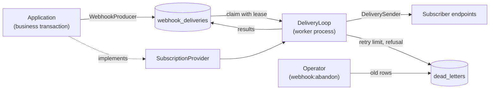

# Webhooks

The webhook queue sends messages to the HTTP endpoints of subscribers. It is
a separate delivery table, `webhook_deliveries`, with a separate worker loop
in the core, `Webhook\DeliveryLoop`. The outbox, the relay and the AMQP path
do not change. This document describes the model, the ports that your
application implements, and the configuration values. The PostgreSQL store and
the HTTP sender are adapters.

**There is no ordering guarantee.** The deliveries of one subscription arrive
in any order, so receivers must be order-insensitive.

## The model



- **Subscription.** `Webhook\Subscription` has an ID (1 to 64 characters), a
  URL and one or more secrets. Your application owns the subscriptions; the
  library has no subscription table. The ID of a subscription is the **lane**
  of its delivery rows.
- **Produce.** `Webhook\WebhookProducer::produce(Message $message, array
  $headers = [])` writes one row for each subscription that
  `SubscriptionProvider::forMessage()` gives. Call it inside your own
  transaction: the rows commit or roll back with your business change. A
  message with no subscription writes no row. A subscription that you add
  later gets no row for an earlier message.
- **Row.** All rows of one message have the same message ID, which the
  receiver gets, so the receiver can remove a duplicate. The body of a row is
  the bytes that the wire format encodes: the same bytes that `OutboxProducer`
  stores. The row holds no URL and no secret. The loop reads the subscription
  of a lane at send time.
- **Claim with a lease.** The loop claims due rows of many lanes in one call:
  at most a row limit for each lane, and at most a total (the batch size, or
  with a rate limiter the sum of the grants; see
  [The loop with flow control](#the-loop-with-flow-control)). The claim moves
  `available_at` of each row forward by the lease and commits before a request
  starts. No transaction is open during the requests.
- **Send.** The loop gives each claimed delivery with its subscription to the
  `DeliverySender` port in one `send()` call. The sender returns one result
  for each delivery: delivered; failed, with an optional retry time from the
  receiver; or refused for all time, with a reason code (for example `gone`).
- **Results.** The loop writes all results in one `complete()` call:
  - Delivered: the final state delivered.
  - Failed: one more attempt, and the retry time from the retry policy.
  - Dead: a dead letter and the final state dead, in one transaction.
- **Lease check.** `complete()` changes a row only when its `available_at` is
  still the lease value of the claim. A worker whose lease ended before its
  result write changes nothing.
- **Worker stop.** A stop between the claim and the result write leaves the
  rows leased. They are due again after the lease, with no attempt used. A
  second request for the same delivery is possible; it has the same message
  ID.
- **No time limit.** A delivery waits until it is delivered, reaches the
  retry limit, or gets a permanent refusal. The age of a row does not end it.
- **Abandon.** An operator ends old rows with `message-broker:webhook:abandon
  --before=<date>`: the rows of a lane whose endpoint is blocked, and the rows
  of a subscription that your application removed. No other rule ends these
  rows. An abandoned row goes to the dead letters with the reason
  `abandoned`, so `dlq:replay` can send it again. A worker that holds the
  lease of an abandoned row can still send its request; its result write
  changes nothing, because of the lease check.
- **Unknown lane.** When `SubscriptionProvider::find()` gives no subscription
  for the lane of a claimed row, the loop sends no request and uses no
  attempt. The row waits until the subscription returns or an operator
  abandons it.
- **Database error.** A database error, and an error of the sender's own code
  or configuration, stops the worker (crash-only, as the relay). The claimed
  rows are due again when their lease ends.

### Dead letters

A delivery goes to the `dead_letters` table when the retry policy decides a
dead letter (by default: the 8th failed attempt), when the result is a
refusal, or when an operator abandons the row. The dead letter has:

| Field | Value |
|---|---|
| `source` | `webhook:<lane>` |
| `messageId`, `messageName`, `body`, `headers` | the values of the row |
| `errorClass` | the reason: `failed`, `refused` or `abandoned` |
| `errorMessage` | the text of the last result; for a refusal `<reason code>: <text>`; for an abandoned row `Abandoned by an operator: created before <date> UTC` |
| `errorTrace` | empty |
| `attempts` | the attempts of the row, with the request of the last result; for an abandoned row the attempts of the row |
| `replayable` | `true` |

The dead letter follows the open row rule of the dead letter store: one open
row for each pair of message ID and source, so one message has one open dead
letter for each lane. `dlq:list`, `dlq:show` and `dlq:stats` read it as each
other dead letter. `dlq:replay` inserts a new delivery row for the lane of the
source, with the message ID and the body of the dead letter, and no outbox
row. Its output names that webhook lane, and the summary of `--all` counts the
webhook replays apart (see
[Replay of a webhook dead letter](DLQ_OPERATIONS.md#replay-of-a-webhook-dead-letter)).

## Flow control

The core has two ports that control the flow of webhook requests: a rate
limiter with a global bucket and a bucket for each lane, and a circuit breaker
for each lane. The delivery loop calls both in each pass (see
[The loop with flow control](#the-loop-with-flow-control)). The test kit has
an in-memory implementation of each. The PostgreSQL adapter implements the
three ports: `PostgreSqlRateLimiter`, and `PostgreSqlCircuitBreaker` (also
`LaneStates`); see
[../postgresql/WEBHOOKS.md](../postgresql/WEBHOOKS.md#flow-control-tables).
The Redis adapter implements the rate limiter in Redis: `RedisRateLimiter`;
see [../redis/RATE_LIMIT.md](../redis/RATE_LIMIT.md). A deployment uses one
rate limit store for all its workers.

A store error of either port propagates: the flow control never fails open.
`Webhook\NoRateLimit` has no bucket, and `Webhook\NoCircuitBreaker` opens no
lane.

### Rate limit

The rate limit has two levels of token buckets that all workers of one
deployment share: one global bucket, and one bucket for each lane with a
limit. A request needs a permit of both, also a retry. A bucket refills at its
rate up to its burst capacity, and a new bucket starts full.

- **`Webhook\Rate`**: the requests each second (a `float` above 0, so
  `new Rate(0.5)` is 30 requests each minute) and the burst capacity (a whole
  number, 1 or more). The burst capacity has a default of one tenth of the
  rate as a whole number (rounded down), with a minimum of 1:
  `new Rate(1_000)` has a burst capacity of 100, and `new Rate(0.5)` has 1.
  There is no value for "no limit".
- **`Webhook\RateLimits`**: the global `Rate`, and a map from a lane to its
  `Rate`. A null global rate means no global bucket. A lane that is not in the
  map has no lane limit.
- **The rates are parameters of each call.** The store holds no rate and no
  burst capacity, so each worker must give the same values.

One `acquire(array $wanted, int $total, RateLimits $limits)` takes the
permits of all lanes of one pass, as one atomic step:

1. The store refills each bucket of the call from its stored time to the
   present time, up to its burst capacity. A present time earlier than the
   stored time gives a refill of 0.
2. The availability of a lane is `min(wanted, floor(lane tokens))`, or the
   wanted count for a lane with no limit. The global grant `G` is
   `min($total, floor(global tokens))`, or `$total` with no global bucket.
3. If the sum of the availabilities is `G` or less, each lane gets its
   availability. Else each lane gets `min(availability, L)`, where the level
   `L` is the largest whole number for which the sum of
   `min(availability, L)` is `G` or less. The rest of `G` goes one permit at a
   time to the lanes above `L`, in the order of the call. This is the max-min
   division: a lane with a large backlog does not take the permits of the
   small lanes.
4. The store subtracts each grant from its lane bucket and the sum from the
   global bucket, and returns the grants.

For example, a global grant of 10 and the availabilities `[8, 2, 5]` give
`[4, 2, 4]`; a global grant of 11 gives `[5, 2, 4]`.

`giveBack(array $unused, RateLimits $limits)` puts each unused count into its
lane bucket and their sum into the global bucket, each up to its burst
capacity.

`Webhook\PermitDivision` holds the rules that each store shares, as pure
functions: `refill()` (step 1) and `divide()` (step 3). The availabilities,
`G`, `L` and the grants are whole numbers; only the tokens of a bucket have
decimals. Thus equal inputs give equal grants in all stores.

The keys of each map are lane IDs. PHP turns a numeric key into an integer, so
an implementation reads each key as a string.

### Circuit breaker

The circuit breaker keeps one state for each lane, which all workers share. A
lane leaves circulation for the open time when the error rate of its count
window reaches the threshold. After the open time, the lane returns with a new
window; there is no probe state. A lane that still fails after a number of
timed openings in a row is blocked until an operator closes it.

- **What counts as a failure:** each result that is not delivered (also a
  refusal and a timeout), and a delivered result whose request time is above
  the slow limit (`CircuitBreakerPolicy::countsAsFailure()`). The caller of
  `record()` makes the counts with the policy of the breaker
  (`CircuitBreaker::policy()`), so the breaker does not know this rule.
- **The trip rule:** the window has the minimum number of requests or more,
  and failures divided by requests is the error rate or more. A trip starts a
  new window and adds 1 to the opened count and to the openings in a row. It
  sets `open_until` to the present time plus the open time.
- **A new window** starts when the present window is older than the window
  length, and at the first `record()` after `open_until` (also when the open
  time is shorter than the window length). That `record()` reports the lane in
  `returned`, one time for each trip.
- **An open lane:** while `open_until` is later than the present time,
  `openLanes()` gives the lane, and `record()` ignores its counts (the results
  of the batches in flight do not move `open_until`).
- **A recovery:** a window that ends with the minimum number of requests or
  more and no trip. The first `record()` after the window length finds it and
  sets the openings in a row to 0.
- **The block:** a trip when the openings in a row already have the maximum
  (default 3) blocks the lane in place of a timed opening: the fourth trip in
  a row sets `blocked_at`, and `record()` reports the lane in `blocked`, not in
  `left`. A blocked lane is out of circulation with no time limit, also after
  its open time, and `record()` ignores its counts. Only
  `LaneStates::close()` ends a block: the command
  `message-broker:webhook:lanes --close=<lane>`. A maximum of 0 turns the
  block off.
- **A close** (`LaneStates::close()`) puts the lane back into circulation:
  `open_until` and the block become `null`, a new window starts, and the
  openings in a row become 0. The opened count stays. A close gives no
  `returned`.

`Webhook\CircuitBreakerPolicy` holds the values, for all lanes together:

| Value | Default | Purpose |
|---|---|---|
| `windowMs` | `300_000` (5 min) | The length of a count window. 1 or more. |
| `minimumRequests` | `10` | The fewest requests in a window for a trip. 1 or more. |
| `errorRatePercent` | `70` | The error rate of a trip, failures divided by requests. 1 to 100. |
| `openMs` | `600_000` (10 min) | The time that a lane is out of circulation after a trip. 1 or more. |
| `slowLimitMs` | `5_000` (5 s) | A delivered result with a longer request time counts as a failure. `0` turns the slow rule off. |
| `maxConsecutiveOpenings` | `3` | The timed openings in a row before a trip blocks the lane (`blocks()`). `0` turns the block off. |

### Lane rates

The rate of a lane comes from your application, not from the store:

1. `Subscription::$rateLimit` (a `?Rate`, default `null`), the rate of the
   subscription of the lane;
2. else `DeliveryLoopConfig::$defaultLaneRate`;
3. else no lane limit: the lane takes permits from the global bucket only.

The loop reads the rates at its lane refresh interval (`laneRefreshMs`): it
calls `lanes()`, then `find(lane)` for each lane. A changed rate has effect
within one refresh interval; for that time, two workers can use different
rates. The global rate is `DeliveryLoopConfig::$globalRate`; `null` means no
global bucket. Give each worker the same values.

### The loop with flow control

Each pass of `DeliveryLoop`:

1. **Lanes.** The lanes of the last refresh, in a new random order.
2. **Open lanes.** The lanes of `CircuitBreaker::openLanes()` leave the pass.
   Their rows wait with their attempts and retry times; they use no attempt.
3. **Due counts.** `DeliveryStore::dueCounts()` for the lanes in circulation,
   with the row limit for each lane (`limitForEachLane`) as the cap. A lane
   with 0 due rows asks for no permit. With no due row in any lane, the pass
   ends and the worker sleeps the idle sleep.
4. **Permits.** `RateLimiter::acquire()` with the due count of each lane, in
   the random order of the pass, the batch size as `$total`, and the
   `RateLimits` of the pass. Each lane whose grant is below its due count
   gives the event `webhook.lane_at_limit`. With a sum of grants of 0, the
   worker records `webhook.permit_wait`, sleeps `permitWaitMs` and does not
   claim.
5. **Claim.** For each lane with a grant above 0, at most `min(row limit,
   grant)` rows; the sum of the grants is the total.
6. **Give back.** `giveBack()` with the grant minus the claimed rows of each
   lane, only for the lanes with a difference above 0. A difference occurs
   when a different worker claimed the counted rows first.
7. **Send, results.** As in [The model](#the-model).
8. **Record.** One `CircuitBreaker::record()` call with the requests and the
   failures of each lane of the batch. The loop makes the counts with
   `CircuitBreaker::policy()`, so the slow limit is the value of the breaker.

With `NoRateLimit` (the default) the loop calls neither `dueCounts()` nor
`acquire()`: the claim takes the row limit for each lane in circulation and
the batch size as the total, and the refresh reads no subscription. With
`NoCircuitBreaker` (the default) no lane leaves circulation.

A worker that stops between the grant and the requests loses its permits: the
rate is then lower for a moment, never higher. A row that becomes due after
the due count waits for the next pass.

```php
use Freyr\MessageBroker\Testing\InMemoryCircuitBreaker;
use Freyr\MessageBroker\Testing\InMemoryRateLimiter;
use Freyr\MessageBroker\Webhook\DeliveryLoop;
use Freyr\MessageBroker\Webhook\DeliveryLoopConfig;
use Freyr\MessageBroker\Webhook\Rate;

$loop = new DeliveryLoop(
    store: $deliveryStore,
    sender: $sender,
    subscriptions: $subscriptions,
    config: new DeliveryLoopConfig(
        batchSize: 100,
        globalRate: new Rate(1_000),          // burst capacity 100: not smaller than the batch size
        defaultLaneRate: new Rate(40),        // a subscription with its own rateLimit overrides it
    ),
    events: $events,
    rateLimiter: new InMemoryRateLimiter(),   // one process only; a shared store comes with an adapter
    circuitBreaker: new InMemoryCircuitBreaker(),
);
```

The in-memory implementations keep their state in one process, so they limit
one worker only. Use them for tests and for a deployment with one worker.

### The flow control ports

| Port | Methods | Notes |
|---|---|---|
| `Webhook\RateLimiter` | `acquire(array $wanted, int $total, RateLimits $limits): array`, `giveBack(array $unused, RateLimits $limits): void` | `acquire()` returns a grant for each lane of `$wanted`, from 0 to its wanted count, in the order of the call; `$total` and the global bucket cap the sum. See [Rate limit](#rate-limit). |
| `Webhook\CircuitBreaker` | `openLanes(): list<string>`, `record(list<LaneCounts> $counts): LaneTransitions`, `policy(): CircuitBreakerPolicy` | `openLanes()` gives the open and the blocked lanes. `record()` writes the counts of all lanes of a batch in one write, in the order of the lane ID, and returns the lanes that left circulation (`left`), the lanes that returned (`returned`) and the lanes that it blocked (`blocked`). `LaneCounts` has `lane`, `requests` (1 or more) and `failures` (0 to `requests`). |
| `Webhook\LaneStates` | `all(): list<LaneState>`, `close(string $lane): bool` | For the operator. `all()` gives each lane with a result, in the order of the lane ID: `lane`, `windowStartedAt`, `requests`, `failures`, `openUntil` (epoch ms, or `null`), `openedCount`, `consecutiveOpenings`, `blockedAt` (epoch ms, or `null`). `close()` returns `false` for a lane with no state. The implementation of `CircuitBreaker` implements it too. |

## The ports that your application implements

| Port | Methods | Notes |
|---|---|---|
| `Webhook\SubscriptionProvider` | `forMessage(string $messageName): list<Subscription>`, `find(string $lane): ?Subscription`, `lanes(): list<string>` | Required. `forMessage()` runs inside your transaction, so it must be fast. `find()` gives `null` for a removed subscription. |
| `Webhook\DeliveryRetryPolicy` | `decide(int $attempt, DeliveryResult $result, DeliveryRecord $delivery): DeliveryDecision` | Optional. The default is `DefaultDeliveryRetryPolicy`. |

The adapters implement `Webhook\DeliveryStore`, `Webhook\DeliverySender` and
`Webhook\DeliveryRetention`. [PORTS.md](PORTS.md) lists all ports.

### The default retry policy

`DefaultDeliveryRetryPolicy(array $delaysMs = SCHEDULE_MS, int
$maxReceiverDelayMs = 86_400_000)`:

- The number of attempts is the number of delays plus 1. The default schedule
  has 8 attempts, with these delays after the failed attempts 1 to 7: 5 s,
  5 min, 30 min, 2 h, 5 h, 10 h, 10 h (about 27.5 hours in total).
- A refused result is a dead letter at once.
- A retry time from the receiver (for example from `Retry-After`) replaces the
  delay when it is later, up to now plus `$maxReceiverDelayMs` (default 1 day).

## Configuration

`Webhook\DeliveryLoopConfig` holds the values of the loop. Each number must be
1 or more; a lane filter must name one or more lanes.

| Value | Default | Purpose |
|---|---|---|
| `leaseMs` | `60_000` (60 s) | The lease of a claim. Must be longer than `DeliverySender::maxSendMs()`. |
| `batchSize` | `100` | The most rows of one claim, all lanes together. |
| `limitForEachLane` | `25` | The most rows of one lane in one claim. |
| `laneRefreshMs` | `30_000` (30 s) | The interval of the read of `SubscriptionProvider::lanes()`. A new subscription waits up to this time. |
| `laneFilter` | `null` | Claim only these lanes; `null` claims all lanes. |
| `idleSleepMs` | `200` | The sleep after a pass that delivered nothing, plus up to a quarter of it as jitter. |
| `permitWaitMs` | `50` | The sleep after a pass whose grants were all 0, in place of the idle sleep. |
| `globalRate` | `null` | The `Rate` of the global bucket; `null` = no global bucket. When set, the batch size must not be larger than its burst capacity. |
| `defaultLaneRate` | `null` | The `Rate` of a lane whose subscription has no `rateLimit`; `null` = no lane limit for such a lane. |

```php
use Freyr\MessageBroker\Webhook\DeliveryLoop;
use Freyr\MessageBroker\Webhook\DeliveryLoopConfig;
use Freyr\MessageBroker\Worker\WorkerLimits;

$loop = new DeliveryLoop(
    store: $deliveryStore,            // the PostgreSQL adapter
    sender: $sender,                  // the HTTP adapter
    subscriptions: $subscriptions,    // your SubscriptionProvider
    config: new DeliveryLoopConfig(batchSize: 100, limitForEachLane: 25),
    logger: $logger,
    events: $events,
);
$loop->run(new WorkerLimits(maxMessages: 10_000));
```

### Start check

`run()` refuses to start, with an `InvalidArgumentException`:

- when the lease is not longer than `maxSendMs()` of the sender. A shorter
  lease lets a second worker claim a row while the first one still sends it;
- when the global rate is set and the batch size is larger than its burst
  capacity. One pass can then never get the permits of a full batch. With a
  null global rate there is no such check.

### Worker limits

`run(?WorkerLimits $limits = null)` checks the limits at the end of each pass,
as `Relay::run()` does. The message count is the number of delivered rows, so
a run can deliver up to one batch above a message limit. A limit stop logs
one `info` line, "Worker limit reached; the worker stops". SIGTERM and SIGINT
stop the loop at the end of the pass when `ext-pcntl` is loaded (see
[PRODUCTION.md](PRODUCTION.md)).

## Commands

The library registers no command. Add the command classes to your console
application, as the other commands (see [CLI_REFERENCE.md](CLI_REFERENCE.md)):

```php
use Freyr\MessageBroker\Adapter\PostgreSql\PostgreSqlCircuitBreaker;
use Freyr\MessageBroker\Adapter\PostgreSql\PostgreSqlDeliveryRetention;
use Freyr\MessageBroker\Adapter\PostgreSql\PostgreSqlDeliverySchemaInstaller;
use Freyr\MessageBroker\Adapter\PostgreSql\PostgreSqlDeliveryStore;
use Freyr\MessageBroker\Adapter\PostgreSql\PostgreSqlRateLimiter;
use Freyr\MessageBroker\Console\WebhookAbandonCommand;
use Freyr\MessageBroker\Console\WebhookLanesCommand;
use Freyr\MessageBroker\Console\WebhookMaintainCommand;
use Freyr\MessageBroker\Console\WebhookRunCommand;
use Freyr\MessageBroker\Console\WebhookSetupCommand;
use Freyr\MessageBroker\Webhook\CircuitBreakerPolicy;
use Freyr\MessageBroker\Webhook\DeliveryLoop;
use Freyr\MessageBroker\Webhook\DeliveryLoopConfig;
use Freyr\MessageBroker\Webhook\Rate;

$config = new DeliveryLoopConfig(batchSize: 100, limitForEachLane: 25, globalRate: new Rate(1_000));
$policy = new CircuitBreakerPolicy();

$application->add(new WebhookSetupCommand(new PostgreSqlDeliverySchemaInstaller($pdo)));
$application->add(new WebhookMaintainCommand(new PostgreSqlDeliveryRetention($pdo)));
$application->add(new WebhookAbandonCommand(new PostgreSqlDeliveryStore($pdo), $events, $logger));
$application->add(new WebhookLanesCommand(new PostgreSqlCircuitBreaker($pdo, $policy)));
$application->add(new WebhookRunCommand(
    static fn (DeliveryLoopConfig $config) => new DeliveryLoop(
        new PostgreSqlDeliveryStore($workerPdo),
        $sender,
        $subscriptions,
        config: $config,
        rateLimiter: new PostgreSqlRateLimiter($workerPdo),
        circuitBreaker: new PostgreSqlCircuitBreaker($workerPdo, $policy),
    ),
    $config,
));
```

| Command | Purpose |
| --- | --- |
| `message-broker:webhook:setup --premake-days=N` | Create the tables, and the daily partitions of `webhook_deliveries`. Run it at deployment. |
| `message-broker:webhook:maintain` | Create the partitions ahead and drop the expired ones, once a day. Options `--retention-days`, `--premake-days`, `--dry-run`; the exit codes of `outbox:maintain`. |
| `message-broker:webhook:run` | Run the delivery loop. Options `--lane` (repeatable), `--batch-size`, `--lane-limit`, and the worker limits `--limit`, `--time-limit`, `--memory-limit`. |
| `message-broker:webhook:abandon --before=<date>` | End the old unfinished rows by date, by hand. Options `--lane` (repeatable) and `--dry-run`. |
| `message-broker:webhook:lanes` | Show the circuit breaker state of each lane. `--close=<lane>` ends an opening or a block. |

**A partition with an unfinished row stays.** A delivery has no time limit,
so `webhook:maintain` keeps an expired partition that holds an unfinished row,
until the row reaches a final state or an operator abandons it. The command
reports such a partition and exits with code 1, and it has no option to drop
it. Alert on that exit code. Then find the lanes of the old rows, and end the
rows that no rule ends with `webhook:abandon` (run it with `--dry-run` first).

## Events

`DeliveryLoop` records the first three `BrokerEvents` for each row that the
store changed. A row that the lease check skipped gives no event.
`webhook:abandon` records `WEBHOOK_ABANDONED` one time for each lane.

| Constant | Name | Context |
|---|---|---|
| `WEBHOOK_DELIVERED` | `webhook.delivered` | `lane`, `message_id`, `delivery_id`, `attempts`, `request_ms` |
| `WEBHOOK_RETRIED` | `webhook.retried` | `lane`, `message_id`, `delivery_id`, `attempts`, `retry_at` (epoch ms) |
| `WEBHOOK_DEAD_LETTERED` | `webhook.dead_lettered` | `lane`, `message_id`, `delivery_id`, `attempts`, `reason` (`failed` or `refused`), `reason_code` (the reason code of a refusal, else `null`) |
| `WEBHOOK_ABANDONED` | `webhook.abandoned` | `lane`, `count` (the abandoned rows of the lane) |

An abandoned row gives no `WEBHOOK_DEAD_LETTERED`. Use the `reason_code` `gone`
to disable a subscription in your application.

The flow control events:

| Constant | Name | Context | When |
|---|---|---|---|
| `WEBHOOK_LANE_OPENED` | `webhook.lane_opened` | `lane` | The `record()` call of this worker took the lane out of circulation for the open time. One for each trip. |
| `WEBHOOK_LANE_BLOCKED` | `webhook.lane_blocked` | `lane` | The `record()` call of this worker blocked the lane, in place of `webhook.lane_opened`. |
| `WEBHOOK_LANE_RETURNED` | `webhook.lane_returned` | `lane` | The `record()` call of this worker started the first window after the open time. One for each trip. |
| `WEBHOOK_PERMIT_WAIT` | `webhook.permit_wait` | `lanes` (the lanes that got a grant of 0, in the order of the pass), `sleep_ms` | Each lane with due rows got a grant of 0; the worker sleeps `permitWaitMs`. The port returns only grants, so the event names no bucket. |
| `WEBHOOK_LANE_AT_LIMIT` | `webhook.lane_at_limit` | `lane`, `wanted` (the due count, at most the row limit), `granted` (also 0) | The grant of the lane was below its due count: a bucket or the batch size limited it. |

Alerts: a `webhook.lane_blocked` (only `LaneStates::close()` ends a block); a lane with many `webhook.lane_opened`; a
`webhook.permit_wait` in most passes for a long time; and a lane with
`webhook.lane_at_limit` in most passes for a long time. For a blocked lane,
`message-broker:webhook:lanes` shows its state; when the endpoint works again,
`message-broker:webhook:lanes --close=<lane>` puts the lane back into
circulation. With the PostgreSQL adapter, a SQL alert on a blocked lane is in
[../postgresql/WEBHOOKS.md](../postgresql/WEBHOOKS.md#flow-control-tables).

## Security

- The URL and the secrets of a subscription are never in a library table, a
  log line, an event or a dead letter.
- The text of a result comes from the sender. It never holds the URL or a
  secret.

## Test kit

`InMemoryDeliveryStore`, `FakeDeliverySender`, `InMemorySubscriptionProvider`
and `DeliveryStoreContractTestCase` are in the test kit, and for the flow
control `InMemoryRateLimiter`, `InMemoryCircuitBreaker` (also a `LaneStates`),
`RateLimiterContractTestCase`, `CircuitBreakerContractTestCase` and
`LaneStatesContractTestCase` (see [TESTING.md](TESTING.md)).
