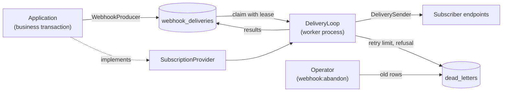

# Webhooks

The webhook queue sends messages to the HTTP endpoints of subscribers. It is
a separate delivery table, `webhook_deliveries`, with a separate worker loop
in the core, `Webhook\DeliveryLoop`. The outbox, the relay and the AMQP path
do not change. This document describes the model, the ports that your
application implements, and the configuration values. The PostgreSQL store and
the HTTP sender are adapters.

**There is no ordering guarantee.** The deliveries of one subscription arrive
in any order, so receivers must be order-insensitive.

## The model



- **Subscription.** `Webhook\Subscription` has an ID (1 to 64 characters), a
  URL and one or more secrets. Your application owns the subscriptions; the
  library has no subscription table. The ID of a subscription is the **lane**
  of its delivery rows.
- **Produce.** `Webhook\WebhookProducer::produce(Message $message, array
  $headers = [])` writes one row for each subscription that
  `SubscriptionProvider::forMessage()` gives. Call it inside your own
  transaction: the rows commit or roll back with your business change. A
  message with no subscription writes no row. A subscription that you add
  later gets no row for an earlier message.
- **Row.** All rows of one message have the same message ID, which the
  receiver gets, so the receiver can remove a duplicate. The body of a row is
  the bytes that the wire format encodes: the same bytes that `OutboxProducer`
  stores. The row holds no URL and no secret. The loop reads the subscription
  of a lane at send time.
- **Claim with a lease.** The loop claims due rows of many lanes in one call:
  at most the batch size, and at most the row limit of each lane. The claim
  moves `available_at` of each row forward by the lease and commits before a
  request starts. No transaction is open during the requests.
- **Send.** The loop gives each claimed delivery with its subscription to the
  `DeliverySender` port in one `send()` call. The sender returns one result
  for each delivery: delivered; failed, with an optional retry time from the
  receiver; or refused for all time, with a reason code (for example `gone`).
- **Results.** The loop writes all results in one `complete()` call:
  - Delivered: the final state delivered.
  - Failed: one more attempt, and the retry time from the retry policy.
  - Dead: a dead letter and the final state dead, in one transaction.
- **Lease check.** `complete()` changes a row only when its `available_at` is
  still the lease value of the claim. A worker whose lease ended before its
  result write changes nothing.
- **Worker stop.** A stop between the claim and the result write leaves the
  rows leased. They are due again after the lease, with no attempt used. A
  second request for the same delivery is possible; it has the same message
  ID.
- **No time limit.** A delivery waits until it is delivered, reaches the
  retry limit, or gets a permanent refusal. The age of a row does not end it.
- **Abandon.** An operator ends old rows with `message-broker:webhook:abandon
  --before=<date>`: the rows of a lane whose endpoint is blocked, and the rows
  of a subscription that your application removed. No other rule ends these
  rows. An abandoned row goes to the dead letters with the reason
  `abandoned`, so `dlq:replay` can send it again. A worker that holds the
  lease of an abandoned row can still send its request; its result write
  changes nothing, because of the lease check.
- **Unknown lane.** When `SubscriptionProvider::find()` gives no subscription
  for the lane of a claimed row, the loop sends no request and uses no
  attempt. The row waits until the subscription returns or an operator
  abandons it.
- **Flow control.** Before a claim, the loop removes the lanes that the
  circuit breaker took out of circulation and takes permits from the global
  rate limit. See [Flow control](#flow-control).
- **Database error.** A database error (also of the rate limiter or the
  circuit breaker), and an error of the sender's own code or configuration,
  stops the worker (crash-only, as the relay). The claimed rows are due again
  when their lease ends.

### Dead letters

A delivery goes to the `dead_letters` table when the retry policy decides a
dead letter (by default: the 8th failed attempt), when the result is a
refusal, or when an operator abandons the row. The dead letter has:

| Field | Value |
|---|---|
| `source` | `webhook:<lane>` |
| `messageId`, `messageName`, `body`, `headers` | the values of the row |
| `errorClass` | the reason: `failed`, `refused` or `abandoned` |
| `errorMessage` | the text of the last result; for a refusal `<reason code>: <text>`; for an abandoned row `Abandoned by an operator: created before <date> UTC` |
| `errorTrace` | empty |
| `attempts` | the attempts of the row, with the request of the last result; for an abandoned row the attempts of the row |
| `replayable` | `true` |

The dead letter follows the open row rule of the dead letter store: one open
row for each pair of message ID and source, so one message has one open dead
letter for each lane. `dlq:list`, `dlq:show` and `dlq:stats` read it as each
other dead letter. `dlq:replay` inserts a new delivery row for the lane of the
source, with the message ID and the body of the dead letter, and no outbox
row. Its output names that webhook lane, and the summary of `--all` counts the
webhook replays apart (see
[Replay of a webhook dead letter](DLQ_OPERATIONS.md#replay-of-a-webhook-dead-letter)).

## Flow control

Two ports of the core control the flow of the loop: a global rate limit and a
circuit breaker for each lane. Each pass of the loop runs these steps:

1. Open lanes: the loop reads `CircuitBreaker::openLanes()` and removes those
   lanes from the lane list. When no lane is left, the pass ends with no
   permit and no claim.
2. Permits: the loop calls `RateLimiter::acquire(batchSize)`. With a grant of
   0, the loop records `webhook.permit_wait`, sleeps `permitWaitMs` and does
   not claim. That pass has no idle sleep.
3. Claim: at most the grant, and at most the row limit of each lane.
4. Give back: when the claim returns fewer rows than the grant, the loop calls
   `RateLimiter::giveBack()` with the difference.
5. Send and results, as above.
6. Record: the loop calls `CircuitBreaker::record()` one time, with the
   requests and the failures of each lane of the batch, after the result
   write. It records `webhook.lane_opened` for each lane that the call took
   out of circulation and `webhook.lane_returned` for each lane that returned.

The flow control never fails open: a database error of either port stops the
worker. `Webhook\NoRateLimit` and `Webhook\NoCircuitBreaker` limit nothing;
the loop uses them when your application gives no rate limiter and no circuit
breaker. To turn a part off, configure its `No` class: there is no schema
change.

### Rate limit

The rate limit is a token bucket that all workers of one deployment share.
Each request needs one permit: a first attempt, a retry, and a request for a
row that a different worker sent before a stop. The bucket refills at the
configured rate (requests each second) and holds at most the burst capacity.
The burst capacity has a default of one tenth of the rate, and a minimum of 1.
The rate and the burst capacity are the configuration of the implementation of
`RateLimiter`; each worker must get the same values.

- The batch size of the loop must not be larger than the burst capacity. Set
  `burstCapacity` of `DeliveryLoopConfig` to the burst capacity of the rate
  limiter, and the loop refuses to start with a larger batch size.
- A worker that stops between the grant and the requests loses its permits.
  The rate is then lower for a moment, never higher.
- The limit is exact at the grant. A worker sends its requests some time after
  the grant, so the requests at the receiver can be a little above the limit
  in a short window.

### Circuit breaker

The circuit breaker keeps one state for each lane, which all workers share. A
lane leaves circulation for the open time when the error rate of its count
window reaches the threshold. After the open time, the lane returns with a new
window; there is no probe state.

- **What counts as a failure:** each result that is not delivered (also a
  refusal and a timeout), and a delivered result whose request time is above
  the slow limit. The row of a slow delivered result stays delivered and uses
  no retry. The loop makes the counts, so the circuit breaker does not know
  this rule.
- **The trip rule:** the window has the minimum number of requests or more,
  and failures divided by requests is the error rate or more. A trip sets
  `open_until` to the present time plus the open time, and starts a new
  window.
- **A new window** starts when the present window is older than the window
  length, and at the first `record()` after `open_until` (also when the open
  time is shorter than the window length).
- **An open lane:** while `open_until` is later than the present time, no
  worker claims the rows of the lane, and `record()` ignores its counts (the
  results of the batches in flight do not move `open_until`). Its deliveries
  keep their `attempts` and their retry time. When the lane returns, they are
  due at the same time, and the rate limit and the row limit for each lane
  spread them. The retry limit still ends a delivery; a delivery has no time
  limit.
- **Requests in flight:** a batch that a worker claimed before the trip
  completes its requests. With W workers, at most W batches reach the lane
  after the trip.
- **Events:** the worker whose `record()` call made the trip records
  `webhook.lane_opened`. The worker whose `record()` call started the first
  window after `open_until` records `webhook.lane_returned`. So each trip has
  one event of each kind. An operator close (`LaneStates::close()`) gives no
  `webhook.lane_returned`.

`Webhook\CircuitBreakerPolicy` holds the values, for all lanes together. Give
the same value to the circuit breaker and to the loop (`breakerPolicy`): the
loop uses the slow limit.

| Value | Default | Purpose |
|---|---|---|
| `windowMs` | `300_000` (5 min) | The length of a count window. 1 or more. |
| `minimumRequests` | `10` | The fewest requests in a window for a trip. 1 or more. |
| `errorRatePercent` | `70` | The error rate of a trip, failures divided by requests. 1 to 100. |
| `openMs` | `600_000` (10 min) | The time that a lane is out of circulation after a trip. 1 or more. |
| `slowLimitMs` | `5_000` (5 s) | A delivered result with a longer request time counts as a failure. `0` turns the slow rule off. |

### The flow control ports

| Port | Methods | Notes |
|---|---|---|
| `Webhook\RateLimiter` | `acquire(int $wanted): int`, `giveBack(int $count): void` | `acquire()` grants 0 to `$wanted` permits. `giveBack()` puts unused permits back, up to the burst capacity. |
| `Webhook\CircuitBreaker` | `openLanes(): list<string>`, `record(list<LaneCounts> $counts): LaneTransitions` | `record()` writes the counts of all lanes of a batch in one write, in the order of the lane ID, and returns the lanes that left circulation (`left`) and the lanes that returned (`returned`). `LaneCounts` has `lane`, `requests` (1 or more) and `failures` (0 to `requests`). |
| `Webhook\LaneStates` | `all(): list<LaneState>`, `close(string $lane): bool` | For the operator. `all()` gives each lane with a result, in the order of the lane ID: `lane`, `windowStartedAt`, `requests`, `failures`, `openUntil` (epoch ms, or `null`), `openedCount`. `close()` sets `openUntil` to `null` and starts a new window; it returns `false` for a lane with no state. The implementation of `CircuitBreaker` implements it too; the loop does not use it. |

```php
use Freyr\MessageBroker\Webhook\CircuitBreakerPolicy;
use Freyr\MessageBroker\Webhook\DeliveryLoop;
use Freyr\MessageBroker\Webhook\DeliveryLoopConfig;

$policy = new CircuitBreakerPolicy(); // the defaults

$loop = new DeliveryLoop(
    store: $deliveryStore,
    sender: $sender,
    subscriptions: $subscriptions,
    config: new DeliveryLoopConfig(batchSize: 100, burstCapacity: 100),
    events: $events,
    rateLimiter: $rateLimiter,        // a RateLimiter with a rate of 1 000 and a burst capacity of 100
    circuitBreaker: $circuitBreaker,  // a CircuitBreaker with the same $policy
    breakerPolicy: $policy,
);
```

## The ports that your application implements

| Port | Methods | Notes |
|---|---|---|
| `Webhook\SubscriptionProvider` | `forMessage(string $messageName): list<Subscription>`, `find(string $lane): ?Subscription`, `lanes(): list<string>` | Required. `forMessage()` runs inside your transaction, so it must be fast. `find()` gives `null` for a removed subscription. |
| `Webhook\DeliveryRetryPolicy` | `decide(int $attempt, DeliveryResult $result, DeliveryRecord $delivery): DeliveryDecision` | Optional. The default is `DefaultDeliveryRetryPolicy`. |

The adapters implement `Webhook\DeliveryStore`, `Webhook\DeliverySender`,
`Webhook\DeliveryRetention`, and the flow control ports `Webhook\RateLimiter`,
`Webhook\CircuitBreaker` and `Webhook\LaneStates`. [PORTS.md](PORTS.md) lists
all ports.

### The default retry policy

`DefaultDeliveryRetryPolicy(array $delaysMs = SCHEDULE_MS, int
$maxReceiverDelayMs = 86_400_000)`:

- The number of attempts is the number of delays plus 1. The default schedule
  has 8 attempts, with these delays after the failed attempts 1 to 7: 5 s,
  5 min, 30 min, 2 h, 5 h, 10 h, 10 h (about 27.5 hours in total).
- A refused result is a dead letter at once.
- A retry time from the receiver (for example from `Retry-After`) replaces the
  delay when it is later, up to now plus `$maxReceiverDelayMs` (default 1 day).

## Configuration

`Webhook\DeliveryLoopConfig` holds the values of the loop. Each number must be
1 or more; a lane filter must name one or more lanes. The values of the flow
control are in [Flow control](#flow-control).

| Value | Default | Purpose |
|---|---|---|
| `leaseMs` | `60_000` (60 s) | The lease of a claim. Must be longer than `DeliverySender::maxSendMs()`. |
| `batchSize` | `100` | The most rows of one claim, all lanes together. |
| `limitForEachLane` | `25` | The most rows of one lane in one claim. |
| `laneRefreshMs` | `30_000` (30 s) | The interval of the read of `SubscriptionProvider::lanes()`. A new subscription waits up to this time. |
| `laneFilter` | `null` | Claim only these lanes; `null` claims all lanes. |
| `idleSleepMs` | `200` | The sleep after a pass that delivered nothing, plus up to a quarter of it as jitter. |
| `permitWaitMs` | `50` | The sleep after a grant of 0 permits of the rate limiter. |
| `burstCapacity` | `null` | The burst capacity of the rate limiter. When it is set, the loop refuses to start with a larger batch size; `null` (for example with `NoRateLimit`) gives no such check. |

```php
use Freyr\MessageBroker\Webhook\DeliveryLoop;
use Freyr\MessageBroker\Webhook\DeliveryLoopConfig;
use Freyr\MessageBroker\Worker\WorkerLimits;

$loop = new DeliveryLoop(
    store: $deliveryStore,            // the PostgreSQL adapter
    sender: $sender,                  // the HTTP adapter
    subscriptions: $subscriptions,    // your SubscriptionProvider
    config: new DeliveryLoopConfig(batchSize: 100, limitForEachLane: 25),
    logger: $logger,
    events: $events,
);
$loop->run(new WorkerLimits(maxMessages: 10_000));
```

### Start check

`run()` refuses to start, with an `InvalidArgumentException`, when:

- The lease is not longer than `maxSendMs()` of the sender. A shorter lease
  lets a second worker claim a row while the first one still sends it.
- `burstCapacity` is set and the batch size is larger than it. A grant is at
  most the burst capacity, so a larger batch size never fills a claim.

### Worker limits

`run(?WorkerLimits $limits = null)` checks the limits at the end of each pass,
as `Relay::run()` does. The message count is the number of delivered rows, so
a run can deliver up to one batch above a message limit. A limit stop logs
one `info` line, "Worker limit reached; the worker stops". SIGTERM and SIGINT
stop the loop at the end of the pass when `ext-pcntl` is loaded (see
[PRODUCTION.md](PRODUCTION.md)).

## Commands

The library registers no command. Add the command classes to your console
application, as the other commands (see [CLI_REFERENCE.md](CLI_REFERENCE.md)):

```php
use Freyr\MessageBroker\Adapter\PostgreSql\PostgreSqlDeliveryRetention;
use Freyr\MessageBroker\Adapter\PostgreSql\PostgreSqlDeliverySchemaInstaller;
use Freyr\MessageBroker\Adapter\PostgreSql\PostgreSqlDeliveryStore;
use Freyr\MessageBroker\Console\WebhookAbandonCommand;
use Freyr\MessageBroker\Console\WebhookMaintainCommand;
use Freyr\MessageBroker\Console\WebhookRunCommand;
use Freyr\MessageBroker\Console\WebhookSetupCommand;
use Freyr\MessageBroker\Webhook\DeliveryLoop;
use Freyr\MessageBroker\Webhook\DeliveryLoopConfig;

$config = new DeliveryLoopConfig(batchSize: 100, limitForEachLane: 25);

$application->add(new WebhookSetupCommand(new PostgreSqlDeliverySchemaInstaller($pdo)));
$application->add(new WebhookMaintainCommand(new PostgreSqlDeliveryRetention($pdo)));
$application->add(new WebhookAbandonCommand(new PostgreSqlDeliveryStore($pdo), $events, $logger));
$application->add(new WebhookRunCommand(
    static fn (DeliveryLoopConfig $config) => new DeliveryLoop(
        new PostgreSqlDeliveryStore($workerPdo),
        $sender,
        $subscriptions,
        config: $config,
    ),
    $config,
));
```

| Command | Purpose |
| --- | --- |
| `message-broker:webhook:setup --premake-days=N` | Create the table and its daily partitions. Run it at deployment. |
| `message-broker:webhook:maintain` | Create the partitions ahead and drop the expired ones, once a day. Options `--retention-days`, `--premake-days`, `--dry-run`; the exit codes of `outbox:maintain`. |
| `message-broker:webhook:run` | Run the delivery loop. Options `--lane` (repeatable), `--batch-size`, `--lane-limit`, and the worker limits `--limit`, `--time-limit`, `--memory-limit`. |
| `message-broker:webhook:abandon --before=<date>` | End the old unfinished rows by date, by hand. Options `--lane` (repeatable) and `--dry-run`. |

**A partition with an unfinished row stays.** A delivery has no time limit,
so `webhook:maintain` keeps an expired partition that holds an unfinished row,
until the row reaches a final state or an operator abandons it. The command
reports such a partition and exits with code 1, and it has no option to drop
it. Alert on that exit code. Then find the lanes of the old rows, and end the
rows that no rule ends with `webhook:abandon` (run it with `--dry-run` first).

## Events

`DeliveryLoop` records the first three `BrokerEvents` for each row that the
store changed. A row that the lease check skipped gives no event.
`webhook:abandon` records `WEBHOOK_ABANDONED` one time for each lane.

| Constant | Name | Context |
|---|---|---|
| `WEBHOOK_DELIVERED` | `webhook.delivered` | `lane`, `message_id`, `delivery_id`, `attempts`, `request_ms` |
| `WEBHOOK_RETRIED` | `webhook.retried` | `lane`, `message_id`, `delivery_id`, `attempts`, `retry_at` (epoch ms) |
| `WEBHOOK_DEAD_LETTERED` | `webhook.dead_lettered` | `lane`, `message_id`, `delivery_id`, `attempts`, `reason` (`failed` or `refused`), `reason_code` (the reason code of a refusal, else `null`) |
| `WEBHOOK_ABANDONED` | `webhook.abandoned` | `lane`, `count` (the abandoned rows of the lane) |

An abandoned row gives no `WEBHOOK_DEAD_LETTERED`. Use the `reason_code` `gone`
to disable a subscription in your application.

The flow control records these events (see [Flow control](#flow-control)):

| Constant | Name | Context |
|---|---|---|
| `WEBHOOK_LANE_OPENED` | `webhook.lane_opened` | `lane`: the circuit breaker took the lane out of circulation. One event for each trip. |
| `WEBHOOK_LANE_RETURNED` | `webhook.lane_returned` | `lane`: the lane is back in circulation after its open time. One event for each trip. |
| `WEBHOOK_PERMIT_WAIT` | `webhook.permit_wait` | `wanted` (the batch size), `sleep_ms`: the rate limiter granted 0 permits. |

Alert on a lane with many `webhook.lane_opened` events, and on a constant
`webhook.permit_wait`.

## Security

- The URL and the secrets of a subscription are never in a library table, a
  log line, an event or a dead letter.
- The text of a result comes from the sender. It never holds the URL or a
  secret.

## Test kit

`InMemoryDeliveryStore`, `FakeDeliverySender`, `InMemorySubscriptionProvider`
and `DeliveryStoreContractTestCase` are in the test kit, and for the flow
control `InMemoryRateLimiter`, `InMemoryCircuitBreaker` (also a `LaneStates`),
`RateLimiterContractTestCase`, `CircuitBreakerContractTestCase` and
`LaneStatesContractTestCase` (see [TESTING.md](TESTING.md)).
