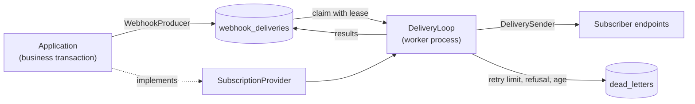

# Webhooks

The webhook queue sends messages to the HTTP endpoints of subscribers. It is
a separate delivery table, `webhook_deliveries`, with a separate worker loop
in the core, `Webhook\DeliveryLoop`. The outbox, the relay and the AMQP path
do not change. This document describes the model, the ports that your
application implements, and the configuration values. The PostgreSQL store and
the HTTP sender are adapters.

**There is no ordering guarantee.** The deliveries of one subscription arrive
in any order, so receivers must be order-insensitive.

## The model



- **Subscription.** `Webhook\Subscription` has an ID (1 to 64 characters), a
  URL and one or more secrets. Your application owns the subscriptions; the
  library has no subscription table. The ID of a subscription is the **lane**
  of its delivery rows.
- **Produce.** `Webhook\WebhookProducer::produce(Message $message, array
  $headers = [])` writes one row for each subscription that
  `SubscriptionProvider::forMessage()` gives. Call it inside your own
  transaction: the rows commit or roll back with your business change. A
  message with no subscription writes no row. A subscription that you add
  later gets no row for an earlier message.
- **Row.** All rows of one message have the same message ID, which the
  receiver gets, so the receiver can remove a duplicate. The body of a row is
  the bytes that the wire format encodes: the same bytes that `OutboxProducer`
  stores. The row holds no URL and no secret. The loop reads the subscription
  of a lane at send time.
- **Claim with a lease.** The loop claims due rows of many lanes in one call:
  at most the batch size, and at most the row limit of each lane. The claim
  moves `available_at` of each row forward by the lease and commits before a
  request starts. No transaction is open during the requests.
- **Send.** The loop gives each claimed delivery with its subscription to the
  `DeliverySender` port in one `send()` call. The sender returns one result
  for each delivery: delivered; failed, with an optional retry time from the
  receiver; or refused for all time, with a reason code (for example `gone`).
- **Results.** The loop writes all results in one `complete()` call:
  - Delivered: the final state delivered.
  - Failed: one more attempt, and the retry time from the retry policy.
  - Dead: a dead letter and the final state dead, in one transaction.
- **Lease check.** `complete()` changes a row only when its `available_at` is
  still the lease value of the claim. A worker whose lease ended before its
  result write changes nothing.
- **Worker stop.** A stop between the claim and the result write leaves the
  rows leased. They are due again after the lease, with no attempt used. A
  second request for the same delivery is possible; it has the same message
  ID.
- **Maximum age.** At an interval, the loop claims the due, unfinished rows
  that are older than the maximum age, from all lanes, and moves them to the
  dead letters with the reason `expired`. This also ends the rows of a
  subscription that your application removed.
- **Unknown lane.** When `SubscriptionProvider::find()` gives no subscription
  for the lane of a claimed row, the loop sends no request and uses no
  attempt. The row waits for the maximum age.
- **Database error.** A database error, and an error of the sender's own code
  or configuration, stops the worker (crash-only, as the relay). The claimed
  rows are due again when their lease ends.

### Dead letters

A delivery goes to the `dead_letters` table when the retry policy decides a
dead letter (by default: the 8th failed attempt), when the result is a
refusal, or when the row passes the maximum age. The dead letter has:

| Field | Value |
|---|---|
| `source` | `webhook:<lane>` |
| `messageId`, `messageName`, `body`, `headers` | the values of the row |
| `errorClass` | the reason: `failed`, `refused` or `expired` |
| `errorMessage` | the text of the last result; for a refusal `<reason code>: <text>`; for an expired row `The delivery is older than the maximum age of <n> ms` |
| `errorTrace` | empty |
| `attempts` | the attempts of the row, with the request of the last result |
| `replayable` | `true` |

The dead letter follows the open row rule of the dead letter store: one open
row for each pair of message ID and source, so one message has one open dead
letter for each lane. `dlq:list`, `dlq:show` and `dlq:stats` read it as each
other dead letter. `dlq:replay` inserts a new delivery row for the lane of the
source, with the message ID and the body of the dead letter, and no outbox
row. Its output names that webhook lane, and the summary of `--all` counts the
webhook replays apart (see
[Replay of a webhook dead letter](DLQ_OPERATIONS.md#replay-of-a-webhook-dead-letter)).

## The ports that your application implements

| Port | Methods | Notes |
|---|---|---|
| `Webhook\SubscriptionProvider` | `forMessage(string $messageName): list<Subscription>`, `find(string $lane): ?Subscription`, `lanes(): list<string>` | Required. `forMessage()` runs inside your transaction, so it must be fast. `find()` gives `null` for a removed subscription. |
| `Webhook\DeliveryRetryPolicy` | `decide(int $attempt, DeliveryResult $result, DeliveryRecord $delivery): DeliveryDecision`, `longestDelayMs(): int` | Optional. The default is `DefaultDeliveryRetryPolicy`. |

The adapters implement `Webhook\DeliveryStore`, `Webhook\DeliverySender` and
`Webhook\DeliveryRetention`. [PORTS.md](PORTS.md) lists all ports.

### The default retry policy

`DefaultDeliveryRetryPolicy(array $delaysMs = SCHEDULE_MS, int
$maxReceiverDelayMs = 86_400_000)`:

- The number of attempts is the number of delays plus 1. The default schedule
  has 8 attempts, with these delays after the failed attempts 1 to 7: 5 s,
  5 min, 30 min, 2 h, 5 h, 10 h, 10 h (about 27.5 hours in total).
- A refused result is a dead letter at once.
- A retry time from the receiver (for example from `Retry-After`) replaces the
  delay when it is later, up to now plus `$maxReceiverDelayMs` (default 1 day).
- `longestDelayMs()` is the longest delay or `$maxReceiverDelayMs`, whichever
  is larger.

## Configuration

`Webhook\DeliveryLoopConfig` holds the values of the loop. Each number must be
1 or more; a lane filter must name one or more lanes.

| Value | Default | Purpose |
|---|---|---|
| `leaseMs` | `60_000` (60 s) | The lease of a claim. Must be longer than `DeliverySender::maxSendMs()`. |
| `batchSize` | `100` | The most rows of one claim, all lanes together. Also the size of one claim of expired rows. |
| `limitForEachLane` | `25` | The most rows of one lane in one claim. |
| `laneRefreshMs` | `30_000` (30 s) | The interval of the read of `SubscriptionProvider::lanes()`. A new subscription waits up to this time. |
| `laneFilter` | `null` | Claim only these lanes; `null` claims all lanes. |
| `maxAgeMs` | `259_200_000` (3 days) | A due, unfinished row older than this goes to the dead letters with the reason `expired`. |
| `expiredCheckIntervalMs` | `60_000` (60 s) | The interval of the check of expired rows. One check claims batches until a batch is not full. |
| `retentionDays` | `7` | The retention period of the table. Use the same value for `--retention-days` of `message-broker:webhook:maintain`. |
| `idleSleepMs` | `200` | The sleep after a pass that delivered nothing, plus up to a quarter of it as jitter. |

```php
use Freyr\MessageBroker\Webhook\DeliveryLoop;
use Freyr\MessageBroker\Webhook\DeliveryLoopConfig;
use Freyr\MessageBroker\Worker\WorkerLimits;

$loop = new DeliveryLoop(
    store: $deliveryStore,            // the PostgreSQL adapter
    sender: $sender,                  // the HTTP adapter
    subscriptions: $subscriptions,    // your SubscriptionProvider
    config: new DeliveryLoopConfig(batchSize: 100, limitForEachLane: 25),
    logger: $logger,
    events: $events,
);
$loop->run(new WorkerLimits(maxMessages: 10_000));
```

### Start checks

`run()` refuses to start, with an `InvalidArgumentException`, when:

- The lease is not longer than `maxSendMs()` of the sender. A shorter lease
  lets a second worker claim a row while the first one still sends it.
- The maximum age plus `longestDelayMs()` of the retry policy is not shorter
  than the retention period. Each row must reach a final state before its
  partition expires: the check of expired rows takes only due rows, so a row
  reaches a final state not later than the maximum age plus the longest retry
  delay. The defaults give 3 days plus 1 day, below 7 days.

### Worker limits

`run(?WorkerLimits $limits = null)` checks the limits at the end of each pass,
as `Relay::run()` does. The message count is the number of delivered rows, so
a run can deliver up to one batch above a message limit. A limit stop logs
one `info` line, "Worker limit reached; the worker stops". SIGTERM and SIGINT
stop the loop at the end of the pass when `ext-pcntl` is loaded (see
[PRODUCTION.md](PRODUCTION.md)).

## Commands

The library registers no command. Add the command classes to your console
application, as the other commands (see [CLI_REFERENCE.md](CLI_REFERENCE.md)):

```php
use Freyr\MessageBroker\Adapter\PostgreSql\PostgreSqlDeliveryRetention;
use Freyr\MessageBroker\Adapter\PostgreSql\PostgreSqlDeliverySchemaInstaller;
use Freyr\MessageBroker\Adapter\PostgreSql\PostgreSqlDeliveryStore;
use Freyr\MessageBroker\Console\WebhookMaintainCommand;
use Freyr\MessageBroker\Console\WebhookRunCommand;
use Freyr\MessageBroker\Console\WebhookSetupCommand;
use Freyr\MessageBroker\Webhook\DeliveryLoop;
use Freyr\MessageBroker\Webhook\DeliveryLoopConfig;

$config = new DeliveryLoopConfig(retentionDays: 7);

$application->add(new WebhookSetupCommand(new PostgreSqlDeliverySchemaInstaller($pdo)));
$application->add(new WebhookMaintainCommand(new PostgreSqlDeliveryRetention($pdo)));
$application->add(new WebhookRunCommand(
    static fn (DeliveryLoopConfig $config) => new DeliveryLoop(
        new PostgreSqlDeliveryStore($workerPdo),
        $sender,
        $subscriptions,
        config: $config,
    ),
    $config,
));
```

| Command | Purpose |
| --- | --- |
| `message-broker:webhook:setup --premake-days=N` | Create the table and its daily partitions. Run it at deployment. |
| `message-broker:webhook:maintain` | Create the partitions ahead and drop the expired ones, once a day. Options `--retention-days`, `--premake-days`, `--dry-run`; the exit codes of `outbox:maintain`. |
| `message-broker:webhook:run` | Run the delivery loop. Options `--lane` (repeatable), `--batch-size`, `--lane-limit`, and the worker limits `--limit`, `--time-limit`, `--memory-limit`. |

**`--retention-days` of `webhook:maintain` and `retentionDays` of the loop
must have the same value.** The start check of the loop proves that each row
reaches a final state inside `retentionDays`. A smaller `--retention-days` lets
a partition expire while it holds unfinished rows: the command keeps it and
exits with code 1, and it has no option to drop it. Alert on that exit code.

## Events

`DeliveryLoop` records these `BrokerEvents` for each row that the store
changed. A row that the lease check skipped gives no event.

| Constant | Name | Context |
|---|---|---|
| `WEBHOOK_DELIVERED` | `webhook.delivered` | `lane`, `message_id`, `delivery_id`, `attempts`, `request_ms` |
| `WEBHOOK_RETRIED` | `webhook.retried` | `lane`, `message_id`, `delivery_id`, `attempts`, `retry_at` (epoch ms) |
| `WEBHOOK_DEAD_LETTERED` | `webhook.dead_lettered` | `lane`, `message_id`, `delivery_id`, `attempts`, `reason` (`failed` or `refused`), `reason_code` (the reason code of a refusal, else `null`) |
| `WEBHOOK_EXPIRED` | `webhook.expired` | `lane`, `message_id`, `delivery_id`, `attempts` |

An expired row gives only `WEBHOOK_EXPIRED`, not `WEBHOOK_DEAD_LETTERED`. Use
the `reason_code` `gone` to disable a subscription in your application.

## Security

- The URL and the secrets of a subscription are never in a library table, a
  log line, an event or a dead letter.
- The text of a result comes from the sender. It never holds the URL or a
  secret.

## Test kit

`InMemoryDeliveryStore`, `FakeDeliverySender`, `InMemorySubscriptionProvider`
and `DeliveryStoreContractTestCase` are in the test kit (see
[TESTING.md](TESTING.md)).
